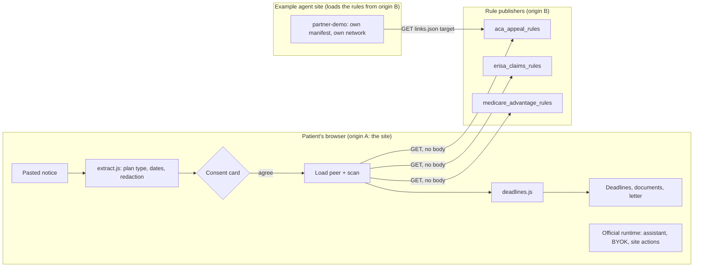

# Appeal Desk

**Your denial letter stays here. The rules come to it.**

Appeal Desk is a static website for people who got a health insurance denial notice in the United States. You paste the notice. It works out the plan type in your browser. Then, after you agree on a consent card, it loads the appeal rules for that plan type from a different website. You get a deadline, a list of documents you can ask for, and a draft appeal letter with a rule cited on each sentence.

It needs no server of ours, no model, and no account. The notice stays in the browser. A model, if you add one, sees only a redacted letter draft.

Live site: {{SITE_URL}}
Video: {{VIDEO_URL}}

> Not legal advice. Appeal Desk drafts a letter and lists dates for you to check. Rules differ by state and by plan. Check your plan documents.

## The problem

- In 2023, insurers on HealthCare.gov plans denied 20% of in-network claims. Fewer than 1% of denied claims were appealed. When people did appeal, the insurer upheld its denial in 56% of cases. (KFF, 2023 data. KFF covers HealthCare.gov plans only, not state marketplaces or employer plans.)
- The deadline depends on the kind of insurance, and each kind has a different rule owner. Job-based and individual ACA plans must allow at least 180 days to appeal (29 CFR 2560.503-1, applied to ACA plans by 45 CFR 147.136), then external review within four months. Medicare Advantage follows CMS rules: 60 days to ask for a reconsideration (42 CFR 422.582), and a denial the plan keeps goes to an independent reviewer automatically (42 CFR 422.592).
- Missing a date can end the appeal. Most people do not know which date applies to them.

## Why the agentic web fits

Appeal rules are public and change slowly. State consumer assistance programs and patient groups know these rules best, and they rarely have servers or a model budget. With the Open Agentic Web profile:

- Whoever owns the rules publishes them as an agent network on any static host.
- The patient's browser loads the rule network, checks it, and computes from its rule table in the page. With a model key, the official runtime can also run the network.
- The site that uses the rules pays for nothing and never sees the notice.

A small nonprofit can ship an appeals expert with no server, no inference bill, and no patient data.

## Try it in 30 seconds

1. Open {{SITE_URL}}.
2. Choose **Try a sample notice** (all samples are fictional), or paste your own text.
3. Press **Check this notice**. Answer the two plan questions if it asks.
4. Read the consent card. It names the publisher of the rule network. Press the button to load it.
5. You get the deadline, the document list and the letter. The panel on the right (**What was sent**) shows 0 bytes of your notice sent to rule publishers.

The thin band at the top walks through six demo scenes. Each scene also opens by hash, for example `#scene-5`.

## What it does

- **Plan type from the notice.** `js/extract.js` reads the notice with patterns and dates. No model.
- **Rules from another origin.** The rule networks live in `peers/`. Each is its own small site with its own `agent-manifest.json`, network JSON and `links.json`. The page loads one only after you agree on the consent card.
- **Deterministic deadlines.** Each rule network carries a rule table in its `metadata.appeal_rules` (days to file, decision times, urgent hours, external review months, documents you can request, and the eCFR link for each). `js/deadlines.js` computes dates from that table. Leap days and month ends are unit tested.
- **A letter with citations.** `js/letter.js` builds the letter. Each sentence has a chip with the rule it relies on. A sentence with no rule shows a grey "no rule cited" chip. You can edit the letter.
- **Document checklist.** The documents you can request, ticked off as you go.
- **Urgent path.** If the notice looks urgent, a banner points to the expedited route (72 hours).
- **Leave nothing on this device.** One button clears everything stored by the page.
- **Optional wording help.** The model is only used to polish the letter, only on the redacted letter draft (placeholders stay as placeholders), and only after you see the exact text and press send. Paths: your own key through the router in the official runtime, or Chrome's built-in model when the browser offers it (experimental, untested in CI).
- **Assistant.** The official runtime's chat panel sits under "Assistant and AI model settings". With a model key, it can read your deadlines, tick a document, or add a standard paragraph to the letter. Every action that changes the page asks you first, including ticking a document.

## Architecture



Three roles. The site is a static bundle. The rule networks are static files on another origin (jsDelivr when deployed). The example partner page is a small agent site of its own (its own `agent-manifest.json`, a one-agent network `maple_street_billing_help`, and a `links.json`). It runs the official runtime and loads the rules from that origin through the same consent card and checks. In the local tests it runs on its own third origin; on the public site it sits beside the main site and still loads the rules from jsDelivr.

Privacy by construction:

- Requests to rule publishers are plain GET requests with no body. The test suite checks that the notice sends 0 bytes.
- `sly_data`, the private context passed between agents, may hold four fields: `plan_type`, `notice_date`, `reason_category`, `urgent`. For peers it holds zero fields. Names, member IDs, claim numbers, birth dates and diagnosis codes are never passed to any agent or peer.
- Anything sent to a model is redacted first, shown to you, and sent only after you confirm.

Checks before a rule network is used (`js/scan.js`):

- The text of the network is searched for hidden instructions: asking for member IDs, "ignore previous instructions", sending data to a URL, hidden characters, requests for keys. A rule that forbids a behaviour ("Never ask for member IDs") is not a finding.
- The rule table is validated: whole numbers in sane ranges, an eCFR link, a document list.
- The URL must match exactly a binding in `links.json`, or one of two test copies (a changed one and a damaged one) used by the demo's error scenes. Another path on the same host is refused.
- Four error cards are readable by a person: a damaged network, a cycle, a budget overrun (too many networks) and a denied origin. A changed copy of the rules that asks for a member ID is blocked with its own card.

## Run it locally

You need Node 20 or newer. No install step.

```
node serve.mjs
```

This starts three local servers that act as three origins:

| Port | Role |
|---|---|
| `127.0.0.1:8080` | the Appeal Desk site |
| `localhost:8081` | the rule networks (`peers/`) |
| `localhost:8082` | the same folder again, so `partner-demo/` (an example agent site that uses the rules) can reach `../runtime` as it will when deployed |

Run the tests with Playwright installed:

```
node test-web.mjs
```

The tests cover date arithmetic, extraction and redaction, scenes 1 to 6, the error cards, a same-tab repeat run, back navigation, 390 px and 1280 px layouts, and that no private value appears in a peer request, a model request or the trace panel. Results for the seven interoperability checks of the Open Agentic Web MVP Profile 0.2 are written to `conformance-results.json` and shown on `conformance.html`: five are checked automatically here (local, three origins); checks 1 (an ordinary HTTPS web host) and 2 (a run with the published default router and model) are checked on the live site after deployment.

Switching the rule networks from local ports to a public host is one edit in `peers.config.json` (set `active` to `deployed`), then `node build.mjs`. See `README-deploy.md` for the host choice and its limits.

## Publish your own rules

You do not need to ask us. If you run a state consumer assistance program, a patient group or a legal aid clinic:

1. Copy a folder from `peers/` (for example `aca_appeal_rules`).
2. Edit `metadata.appeal_rules` in its network JSON: your numbers, your citations, your documents. Set `"verified": true` only when you checked each value against the source.
3. Put the folder on any static host that allows cross-origin GET.
4. Change one line in `peers.config.json` to point at your URL and run `node build.mjs`. It rewrites `links.json`, the peer tools and `allowed_peers` (and a partner site's `links.json`, manifest and network).

The site loads your rules the same way, behind the same consent card and the same scan. It labels the publisher by name, so rules from you do not look like rules from us.

Planned: a listing in the official `agentic_websites.md` of `cognizant-ai-labs/agentic-web`. Not done yet.

## Compared with Fight Health Insurance

[Fight Health Insurance](https://github.com/totallylegitco/fighthealthinsurance) is a free, open-source tool (mostly Apache 2.0) that helps patients appeal denials. It is a server application: you upload a denial and get an explanation and a drafted appeal. Identifying details are scrubbed in the browser before upload. Its drafts are written by language models, so its wording is richer and more flexible than the fixed letter template here. It does things Appeal Desk does not, and it works well today.

Appeal Desk takes a different path for different reasons:

| | Appeal Desk | Fight Health Insurance |
|---|---|---|
| Where the notice goes | stays in the browser | uploaded to the server (details scrubbed first) |
| Needs a backend or model | no | yes (hosted or self-hosted model) |
| Letter | fixed template, a cited rule on each sentence | model-written, more flexible |
| Who can add rules | anyone who hosts a rule network | the maintainers |

They can be used together: a person could use Appeal Desk for the dates and documents, and a server tool for richer wording.

## Limits

- The rule networks here were published by Appeal Desk, copied from eCFR. They are not published by the rule owners. They say so in their manifests. Nothing here is from HHS, DOL or CMS.
- State law can differ. A state external review process can give more time.
- The ACA 180-day figure comes from 45 CFR 147.136 applying 29 CFR 2560.503-1. It is cited that way in the rule table.
- Medicare Advantage covers the standard reconsideration path. Part D and other cases are not covered.
- The rule networks will be served from the public jsDelivr origin. `allowed_peers` therefore names a wide origin. The exact-URL match against `links.json` narrows it again, and a test checks that another path on the same host is refused.
- The runtime builds a tool name from the first 60 characters of the peer URL path. Long jsDelivr paths would make the three names collide, so `build.mjs` refuses such a set. The deployed layout puts the rule networks in a short folder `ad/` at the repository root (`ad/aca`, `ad/erisa`, `ad/ma`); `build.mjs` writes them to `deploy-root/ad/` and checks the names (see `README-deploy.md`). Local ports are not affected.
- The Chrome built-in model path is experimental and untested in CI (a headless browser cannot run it).
- The behaviour on a public host (jsDelivr) is checked only after deployment. Local ports stand in for the three origins in tests.
- Samples are fictional. Plan names and people are made up.
- Not legal advice.

## License and credits

- Code: Apache-2.0 (`LICENSE`).
- `runtime/`: unchanged copy of the Open Agentic Web runtime from `cognizant-ai-labs/agentic-web`, Apache-2.0. Commit hash in `VENDOR.md`.
- `site.js` and `site-actions.js` are adapted from the official agentify-website templates. `bridge/`, `.well-known/`, `agent-mcp.json` and the `*.network.json` files are generated by the skill's `build_network.mjs`.
- Public Sans: SIL OFL 1.1 (`fonts/OFL.txt`).
- Icons: Lucide, ISC (license text in `VENDOR.md`).
- Rule text and numbers: eCFR (ecfr.gov), a work of the US government. KFF figures are cited from KFF's 2023 brief.
